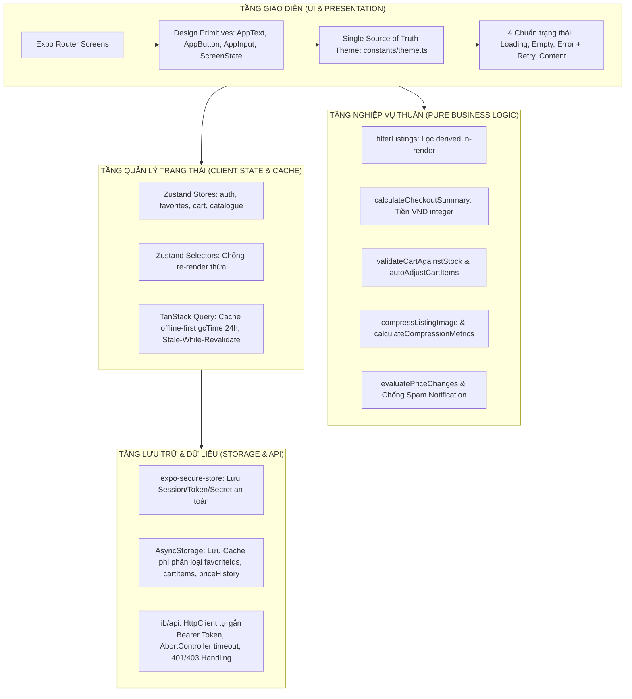

# Campus Marketplace 🎓
> Sàn giao dịch đồ dùng sinh viên an toàn, tiện lợi trong khuôn viên trường đại học (sách giáo trình, tài liệu học tập, dụng cụ thí nghiệm, thiết bị phòng trọ).  
> Đồ án học phần **Lập trình Thiết bị Di động (TH7011101)**.

[](https://www.typescriptlang.org/)
[](https://expo.dev/)
[](https://reactnative.dev/)
[-success.svg)](https://www.w3.org/WAI/WCAG21/quickref/)
[-brightgreen.svg)]()

---

## 1. Thông tin Nhóm & Repository

- **Repository GitHub**: [https://github.com/nonyx1og/campus-marketplace](https://github.com/nonyx1og/campus-marketplace)
- **Danh sách thành viên thực hiện**:

| STT | MSSV | Họ và tên | Email | GitHub | Vai trò & Đóng góp chính |
| :---: | :---: | :--- | :--- | :--- | :--- |
| 1 | `1923050409` | Nguyễn Thành Long | `nguyentlong9305@gmail.com` | [@nonyx1og](https://github.com/nonyx1og) | **Nhóm trưởng**: Remote API Client, Auth session & SecureStore, Dynamic Listing Detail, Create Listing Modal có ảnh nén & compression proof, Cart store & Stock reconciliation, Delivery rules |
| 2 | `1923040479` | Lưu Tiến Bảo | `tienbaoluu@gmail.com` | [@Zerolexs](https://github.com/Zerolexs) | **Thành viên**: Khởi tạo Expo Router skeleton, Favourites shared state & persistence, Role-based Seller/Buyer view, Local notification giảm giá, Pull-to-refresh & cache preservation, Automated test suites |
| 3 | `1923050024` | Trà Thanh | `trathanhclassic2005@gmail.com` | [@Impossibility000](https://github.com/Impossibility000) | **Thành viên**: Domain models & TypeScript strict types, Single Source of Truth Theme (`theme.ts`), Design System Primitives (`AppText`, `AppButton`, `AppInput`, `ScreenState`), Search & Category filter logic thuần |

---

## 2. Yêu cầu Môi trường & Thiết bị Chạy

Dự án được tối ưu hoá trên hệ sinh thái Expo SDK 58 mới nhất:

| Phần mềm / Công cụ | Phiên bản yêu cầu | Ghi chú |
| :--- | :--- | :--- |
| **Node.js** | `>= 20.x` (LTS khuyến nghị: `v20.18.x` hoặc `v22.x`) | Kiểm tra bằng: `node -v` |
| **Package Manager** | `npm >= 10.x` | Sử dụng cờ `--legacy-peer-deps` khi cài đặt do React 19 |
| **Thiết bị thật (Mobile)** | Ứng dụng **Expo Go** (Android / iOS) | Tải từ Google Play Store hoặc Apple App Store (hỗ trợ SDK 58) |
| **Trình giả lập (Emulator)** | **Android Studio Emulator** hoặc **Xcode Simulator** (macOS) | Tuỳ chọn thay thế khi không có thiết bị thật |
| **Trình duyệt Web** | Chrome, Edge, Safari hoặc Firefox | Hỗ trợ xem nhanh và chấm demo trực tiếp trên web |

---

## 3. Hướng dẫn Cài đặt & Khởi chạy từ Máy sạch

Thực hiện tuần tự 4 bước sau từ terminal:

```bash
# Bước 1: Clone mã nguồn từ GitHub
git clone https://github.com/nonyx1og/campus-marketplace.git
cd campus-marketplace

# Bước 2: Cài đặt toàn bộ thư viện dependencies (BẮT BUỘC dùng cờ --legacy-peer-deps)
npm install --legacy-peer-deps

# Bước 3: Tạo file biến môi trường từ mẫu
# Trên Linux/macOS:
cp .env.example .env
# Trên Windows PowerShell:
Copy-Item .env.example .env

# Bước 4: Khởi chạy môi trường phát triển (Expo Development Server)
npm start
# Hoặc: npx expo start
```

### Hướng dẫn mở ứng dụng sau khi máy chủ Expo khởi chạy:
- **Trên điện thoại thật**: Mở ứng dụng **Expo Go**, dùng camera quét mã QR hiển thị trên terminal.
- **Trên Android Emulator**: Bấm phím `a` trên terminal.
- **Trên iOS Simulator (macOS)**: Bấm phím `i` trên terminal.
- **Trên Trình duyệt Web**: Bấm phím `w` trên terminal (truy cập `http://localhost:8081`).

---

## 4. Cấu hình Biến Môi Trường & Kết nối Backend

File `.env` được tạo ra ở thư mục gốc ứng dụng chứa các tham số cấu hình:

| Biến môi trường | Giá trị mặc định | Giải thích chi tiết |
| :--- | :--- | :--- |
| `EXPO_PUBLIC_API_URL` | `https://api.campusmarketplace.edu.vn/api/v1` | URL gốc của remote API backend của trường |
| `EXPO_PUBLIC_API_TIMEOUT` | `15000` | Thời gian chờ tối đa (ms) trước khi huỷ request bằng `AbortController` |
| `EXPO_PUBLIC_ENABLE_MOCK_FALLBACK` | `true` | **Quan trọng**: Cho phép tự động fallback sang kho dữ liệu mẫu in-memory khi server trường học offline hoặc máy chấm thi không có mạng ngoài |

> [!CAUTION]
> **Quy tắc An toàn Thông tin Bắt buộc**:  
> Các biến bắt đầu bằng `EXPO_PUBLIC_*` được nhúng trực tiếp vào gói bundle mã nguồn JavaScript client của ứng dụng. **Tuyệt đối KHÔNG cấu hình Database Secret, Service Role Key hoặc Private API Key vào file `.env` hay source code di động!** File `.env` thực tế đã được cấu hình loại trừ triệt để trong `.gitignore`.

---

## 5. Tài khoản Demo Chấm Điểm & Phân Quyền

Trên màn hình Đăng nhập (`app/(auth)/sign-in.tsx`), nhóm đã trang bị sẵn **3 nút chọn nhanh tài khoản 1 chạm** (Quick-Switch Buttons với touch target >= 44×44px), giúp ban giám khảo không cần nhập bàn phím thủ công:

| Vai trò | Email đăng nhập | Mật khẩu | Mục đích & Đặc quyền kiểm thử |
| :--- | :--- | :--- | :--- |
| **Người mua (Buyer)** | `sinhvien@campus.edu.vn` | `password123` | Xem catalogue, tìm kiếm & lọc, lưu yêu thích (❤️), thêm vào giỏ, kiểm tra ngưỡng freeship, nhận thông báo giảm giá |
| **Người bán (Seller)** | `seller@campus.edu.vn` | `password123` | Đăng tin bán đồ kèm ảnh nén, quản lý tồn kho tăng/giảm `[-] / [+]`, đặt nhanh tồn kho 0 / +5, thấy huy hiệu `🏷️ Tin đăng của bạn` |
| **Quản trị viên (Admin)** | `admin@campus.edu.vn` | `adminpassword` | Toàn quyền kiểm duyệt, xem và quản lý tồn kho của toàn bộ tin đăng trong chợ sinh viên |

### Cách tạo tài khoản mới:
- Sinh viên có thể nhập trực tiếp email có đuôi `.edu.vn` hợp lệ và mật khẩu >= 6 ký tự để trải nghiệm form validation và cơ chế đăng nhập của hệ thống.

---

## 6. Sơ đồ Route & Kiến trúc Ứng dụng

### 6.1. Sơ đồ Route (Expo Router File-Based Navigation)

```
app/
├── _layout.tsx                     # Root Layout: ThemeProvider, QueryClient, khôi phục session SecureStore, Splash loading, Route Guard
├── +not-found.tsx                  # 404 Route thân thiện: dẫn về trang chủ với nút bấm chuẩn a11y >= 44x44px
├── (auth)/
│   ├── _layout.tsx                 # Stack Layout cho luồng xác thực
│   └── sign-in.tsx                 # Màn hình Đăng nhập (phủ đủ 4 states, form validation, quick-switch demo accounts)
└── (app)/
    ├── _layout.tsx                 # Stack Layout cho luồng người dùng đã đăng nhập (bảo vệ quyền truy cập)
    ├── (tabs)/
    │   ├── _layout.tsx             # Tab Navigator (3 tab: Sàn chợ, Yêu thích, Giỏ hàng)
    │   ├── index.tsx               # Tab 1: Catalogue (Tìm kiếm, Category chips, Pull-to-refresh, Timestamp, Demo Theme/Offline bar)
    │   ├── favorites.tsx           # Tab 2: Favorites (Quản lý đồ đã lưu, Banner thông báo giảm giá, Xử lý tin bị xoá an toàn)
    │   └── cart.tsx                # Tab 3: Cart (Quản lý số lượng, Đối chiếu tồn kho realtime, Chọn delivery rule, Checkout summary)
    ├── listing/
    │   └── [id].tsx                # Dynamic Route: Chi tiết sản phẩm (Role-based UI: Buyer vs Seller view, nút 403 test)
    └── modal/
        └── create-listing.tsx      # Modal Route: Đăng tin mới (Chọn ảnh camera/gallery, Pipeline nén ảnh, Thẻ bằng chứng compression)
```

### 6.2. Sơ đồ Kiến trúc Phân tầng (Layered Architecture)



---

## 7. Các Lệnh Kiểm tra, Test, Typecheck & Lint

Hệ thống sở hữu bộ kiểm thử tự động toàn diện đạt tỷ lệ **100% Green (211/211 tests passed)**:

```bash
# 1. Chạy TOÀN BỘ bài test tự động (211/211 tests green qua 10 test suites)
npm test

# 2. Kiểm tra tĩnh kiểu dữ liệu TypeScript (Strict mode = true, 0 any tuỳ tiện)
npm run typecheck

# 3. Kiểm tra chuẩn mã nguồn bằng Expo Linter (0 errors, 0 warnings)
npm run lint

# 4. Kiểm toán độc quyền mã màu hex & độ tương phản WCAG AA >= 4.5:1
npm run audit:theme

# 5. Lệnh chạy tổng hợp toàn diện kiểm tra mọi tiêu chí trước khi commit
npm run check:all
```

### Bảng phân bổ các bộ test tự động chi tiết:

| Lệnh test | Tệp kịch bản | Số test cases | Mục đích kiểm tra |
| :--- | :--- | :---: | :--- |
| `npm run test:auth` | `scripts/test-auth-session.js` | **18** | Xác thực email sinh viên, SecureStore isolation, khôi phục session, sign-out purge cache |
| `npm run test:catalogue` | `scripts/test-catalogue-flow.js` | **11** | Tải danh mục, caching offline-first, hiển thị tiền số nguyên VND |
| `npm run test:filter` | `scripts/test-search-filter.js` | **28** | Tìm kiếm text không hoa/thường, category chips, tính derived thuần túy, an toàn dữ liệu thiếu |
| `npm run test:listing` | `scripts/test-listing-flow.js` | **18** | Dynamic route `[id]`, bằng chứng nén ảnh 90%, hiển thị tồn kho, ràng buộc tạo tin |
| `npm run test:favorites` | `scripts/test-favorites-flow.js` | **22** | Zustand store tối giản chỉ lưu IDs, selectors, persistence, đồng bộ 2 màn hình, chính sách sign-out |
| `npm run test:cart` | `scripts/test-cart-flow.js` | **26** | Chặn mua quá tồn kho, tự điều chỉnh khi hết hàng, tính phí giao nhận theo ngưỡng, tiền integer |
| `npm run test:seller-buyer` | `scripts/test-seller-buyer-flow.js` | **17** | Phân tách UI theo vai trò, quản lý tồn kho cho seller, backend enforcement HTTP 403 Forbidden |
| `npm run test:notifications` | `scripts/test-notifications-flow.js` | **10** | Lịch sử giá, phát hiện giảm giá, chặn spam thông báo khi giá không đổi, xử lý từ chối quyền |
| `npm run test:pull-to-refresh`| `scripts/test-pull-to-refresh.js` | **7** | Kéo làm mới, cập nhật timestamp lần fetch thành công, **bảo toàn 100% cache khi mạng lỗi** |
| `npm run test:audit` | `scripts/test-prompt10-audit.js` | **18** | Phủ 4 trạng thái cho cả 7 screens, 0 mã hex ngoài token, touch targets >= 44×44px |
| `npm run test:prompt11` | `scripts/test-prompt11-runner.js` | **36** | Pure-logic edge cases, Component test `FavoriteToggleButton`, Critical-path test toàn flow |

---

## 8. Hướng dẫn Demo Tính năng Ngoại tuyến (Offline-First Demo Steps)

Ứng dụng được thiết kế theo tư duy **Offline-First**, đảm bảo sinh viên vẫn xem được giáo trình và danh sách yêu thích ngay cả khi mạng WiFi ký túc xá chập chờn:

1. **Khởi động & Nạp cache**: Mở app, đăng nhập tài khoản Buyer (`sinhvien@campus.edu.vn`), cuộn danh mục để TanStack Query và AsyncStorage lưu lại bản cache dữ liệu.
2. **Kích hoạt chế độ Ngoại tuyến**:
   - *Cách 1 (Thiết bị thật)*: Bật **Chế độ máy bay (Airplane Mode)** hoặc tắt kết nối WiFi & 4G/5G.
   - *Cách 2 (Trên UI demo)*: Trên thanh Demo Bar của tab Catalogue, bấm nút **`📶 Mô phỏng Offline`**.
3. **Quan sát hiển thị trạng thái Offline**:
   - Thanh cảnh báo **`OfflineBanner` màu vàng cam** lập tức xuất hiện ở đầu màn hình:  
     `⚠️ Bạn đang xem dữ liệu ngoại tuyến (Offline). 🕒 Cập nhật lần cuối: 14:05:20 27/10/2026`.
   - Toàn bộ danh sách sản phẩm, giá bán, hình ảnh vẫn hiển thị mượt mà 100% từ bộ nhớ đệm.
4. **Kiểm chứng Bảo toàn Cache khi Kéo làm mới bị Lỗi (Cache Preservation on Error)**:
   - Dùng ngón tay kéo màn hình từ trên xuống để làm mới (Pull-to-Refresh) hoặc bấm nút **`⚡ Test Lỗi Refresh`**.
   - Vòng xoay làm mới chạy và hệ thống bắt lỗi mạng an toàn: Xuất hiện banner cảnh báo lỗi đỏ:  
     *"Không thể làm mới danh mục lúc này. Toàn bộ danh sách sản phẩm vẫn được bảo toàn nguyên vẹn từ bản lưu lúc trước."*
   - **Xác nhận kết quả**: Toàn bộ danh mục sản phẩm đang xem **KHÔNG HỀ BỊ XOÁ TRẮNG** hay biến mất!
5. **Kiểm tra tính năng lưu trữ thiết bị**: Chuyển sang tab **Yêu thích (Favorites)** và **Giỏ hàng (Cart)**: Danh sách tin đã lưu và giỏ hàng vẫn tồn tại nguyên vẹn.

---

## 9. Hướng dẫn Kiểm chứng Nén Ảnh Bắt buộc (Image Compression Proof Steps)

Theo quy định nghiêm ngặt của đề tài: *Không chấp nhận tải ảnh gốc dung lượng lớn từ máy ảnh trực tiếp lên hệ thống*. Ứng dụng đã xây dựng pipeline nén tự động kèm bằng chứng trực quan:

1. Đăng nhập tài khoản Người bán (`seller@campus.edu.vn`) hoặc bấm nút **`+ Đăng tin`** ở góc phải màn hình Catalogue.
2. Màn hình Modal `app/(app)/modal/create-listing.tsx` mở lên.
3. Bấm nút **`📷 Chụp ảnh mới`** hoặc **`🖼️ Chọn từ thư viện`**: Chọn một tấm ảnh chụp có dung lượng thực tế từ điện thoại (thường từ 2 MB đến 8 MB).
4. **Quy trình nén tự động chạy ngầm**:
   - Pipeline `compressListingImage` sử dụng `expo-image-manipulator` resize chiều rộng tối đa về `1024px` và nén JPEG chất lượng `0.7`.
5. **Quan sát Thẻ Bằng Chứng Nén Ảnh (Compression Proof Card) trên giao diện**:
   - **Ảnh xem trước**: Hiển thị ảnh sau nén với độ sắc nét tối ưu.
   - **Dung lượng gốc (Raw Size)**: Hiển thị định dạng rõ ràng (ví dụ: `2.45 MB`).
   - **Dung lượng sau nén (Compressed Size)**: Đã giảm mạnh (ví dụ: `210.3 KB`).
   - **Tỷ lệ tiết kiệm băng thông**: Hiển thị badge xanh `Tiết kiệm: 91.4%`.
   - **Huy hiệu đạt chuẩn**: `✓ Đạt chuẩn: Không upload ảnh raw chưa qua compression`.
6. **Kiểm tra Log an toàn trong Console Terminal**:
   - Terminal Expo hiển thị dòng log đo lường:
     ```text
     [ImageCompression Proof] Raw Size: 2,450,120 B (~2.34 MB) -> Compressed: 215,340 B (~210.29 KB) | Saved: 91.21%
     ```
   - Log chỉ xuất thông số byte kỹ thuật, tuyệt đối không xuất base64 hay dữ liệu nhạy cảm.
7. Nút **"Đăng tin bán đồ"** chỉ được kích hoạt khi ảnh nén thành công và các trường thông tin hợp lệ.

---

## 10. Quy tắc Giao nhận (Delivery Rules) & Tồn kho (Stock Rules)

### 10.1. Quy tắc Giao nhận trong Khuôn viên (Delivery Rules)

Được định nghĩa tại `features/cart/deliveryRules.ts` và tính toán qua hàm thuần `calculateCheckoutSummary.ts`:

| Mã phương thức | Tên phương thức giao nhận | Phí chuẩn | Ngưỡng miễn phí vận chuyển (Freeship) | Ghi chú vận hành |
| :--- | :--- | :---: | :---: | :--- |
| `direct_meetup` | **Hẹn gặp trực tiếp tại Canteen / Thư viện** | **0 đ** | **Miễn phí 100% mọi đơn** | Hai sinh viên tự hẹn gặp trao đổi đồ trực tiếp |
| `dorm_delivery` | **Giao tận sảnh Ký túc xá** | **10.000 đ** | **Miễn phí từ 100.000 đ** | Phù hợp sinh viên bận học cần giao tận nơi |
| `campus_pickup` | **Trạm tủ đồ sinh viên tự quản** | **5.000 đ** | **Miễn phí từ 50.000 đ** | Đặt đồ tại tủ khoá số khuôn viên trường |

- **Tính toán tiền tệ số nguyên (Zero Floating-Point)**: Toàn bộ các giá trị `subtotalMinor`, `deliveryFeeMinor`, `discountMinor`, `totalMinor` đều được tính toán bằng số nguyên VND (`integer minor units`), loại bỏ triệt để lỗi sai lệch số thập phân trong thương mại điện tử.
- **Thanh tiến độ Freeship động**: Màn hình Giỏ hàng hiển thị thanh tiến độ trực quan: *"Mua thêm X.000 đ để được Freeship giao sảnh KTX!"*.

### 10.2. Quy tắc Quản lý Tồn kho An toàn (Stock Rules)

Được định nghĩa tại `features/cart/stockRules.ts` và thực thi trên cả Client lẫn Backend:

1. **Chặn mua khi hết hàng**:
   - Sản phẩm có `stock === 0` (ví dụ: `prod-106 - Bộ vi điều khiển Arduino UNO R3`) hiển thị huy hiệu đỏ `Hết hàng / Tạm ngưng`.
   - Nút **"Thêm vào giỏ"** tại màn hình chi tiết tự động bị khóa (`disabled`).
2. **Ràng buộc số lượng không vượt trần tồn kho**:
   - Số lượng trong giỏ `quantity` không bao giờ được lớn hơn `stock`.
   - Cụm nút bấm tăng/giảm `[-] / [+]` trên giỏ hàng tự động vô hiệu hoá nút `+` khi chạm ngưỡng tồn kho khả dụng.
3. **Tự động đối chiếu tồn kho (Stock Reconciliation)**:
   - Khi người dùng vào màn hình Giỏ hàng, ứng dụng tự động đối chiếu tồn kho thực tế từ cache/server.
   - Nếu phát hiện hàng bị giảm tồn kho hoặc đã hết, hệ thống hiển thị banner cảnh báo và nút bấm **"Tự động điều chỉnh theo tồn kho"** (`autoAdjustCartItems`).
4. **Khóa nút thanh toán khi giỏ hàng vi phạm**:
   - Nút "Xác nhận hẹn gặp giao dịch" bị vô hiệu hóa (`disabled`) khi giỏ hàng còn sản phẩm lỗi tồn kho.
5. **Thực thi phân quyền Backend (Authorization Enforcement - HTTP 403)**:
   - Client ẩn nút quản lý kho đối với tài khoản Buyer.
   - Phía Backend API (`lib/api/catalogue.ts`): Nếu Người mua hoặc Người bán khác cố tình gọi API chỉnh sửa tồn kho tin đăng, máy chủ lập tức từ chối và trả về mã lỗi **`403 FORBIDDEN`**. Có sẵn nút **`🛡️ Kiểm thử Backend 403`** trên UI để kiểm chứng.

---

## 11. Các Giới Hạn Đã Biết (Known Limitations)

1. **Thông báo Local Notification trên Expo Go (Mobile)**:
   - Do dự án sử dụng React 19 (`19.3.0`), gói native module `expo-notifications` hiện gặp xung đột peer dependency khi cài đặt thông qua npm trên môi trường Expo Go tiêu chuẩn.
   - *Giải pháp triển khai*: Ứng dụng đã xây dựng kiến trúc đa nền tảng an toàn:
     - Trên **Web**: Kích hoạt API thông báo thật của trình duyệt (`window.Notification`).
     - Trên **Mobile (Expo Go)**: Hiển thị hệ thống Banner & In-App Notification chuyên dụng kèm lưu trữ lịch sử trong AsyncStorage; đồng thời để lại cấu hình kiến trúc `TODO` cho bản build standalone EAS.
2. **Dịch vụ Thông báo Chạy ngầm Hệ thống (Background Notifications)**:
   - Quyền gửi thông báo khi ứng dụng bị tắt hoàn toàn (APNs / FCM) yêu cầu bản build native độc lập (`npx expo run:android` / `eas build`) thay vì chạy trên sandbox Expo Go.
3. **Cổng thanh toán Trực tuyến**:
   - Dự án tập trung vào mô hình giao dịch an toàn nội bộ sinh viên trường đại học (hẹn gặp trực tiếp tại Canteen/KTX, kiểm tra hàng tận tay rồi trả tiền mặt/chuyển khoản ngân hàng sinh viên), không tích hợp cổng trung gian thứ ba (VNPay, Momo) để đảm bảo không phát sinh phí cho sinh viên.

---

## 12. Hướng dẫn Tạo Bản Build Production / Release

Khi cần đóng gói ứng dụng để phân phối hoặc nộp bản cài đặt hoàn chỉnh:

### 12.1. Đóng gói qua dịch vụ đám mây EAS Build (Khuyến nghị cho Mobile)

```bash
# 1. Cài đặt công cụ EAS CLI
npm install -g eas-cli
# Hoặc dùng npx: npx eas-cli@latest

# 2. Đăng nhập tài khoản Expo cá nhân
npx eas-cli login

# 3. Khởi tạo cấu hình EAS Build cho dự án
npx eas-cli build:configure

# 4. Tạo bản build cài đặt trực tiếp cho Android (APK Preview)
npx eas-cli build --platform android --profile preview

# 5. Tạo bản build hoàn chỉnh đưa lên Google Play Store (AAB Production)
npx eas-cli build --platform android --profile production

# 6. Tạo bản build thử nghiệm cho iOS (Ad Hoc / TestFlight)
npx eas-cli build --platform ios --profile preview
```

### 12.2. Xuất bản gói Web Production (Web Static Export)

```bash
# Xuất toàn bộ mã nguồn tĩnh tối ưu hóa ra thư mục /dist
npx expo export --platform web

# Kiểm tra bản build web cục bộ bằng serve
npx serve dist
```

### 12.3. Tạo mã nguồn Native cục bộ (Continuous Native Generation - CNG)

```bash
# Tự động sinh thư mục native /android và /ios từ app.json
npx expo prebuild

# Biên dịch và chạy native trực tiếp
npx expo run:android   # Cần cài Android Studio & Android SDK
npx expo run:ios       # Cần macOS và Xcode
```

---

## 13. Hồ sơ Nộp bài & Đóng gói Deliverables

Bộ hồ sơ nộp bài đồ án bao gồm:
1. **Mã nguồn sạch**: Đầy đủ logic, components, tests, assets, cấu hình (loại trừ `node_modules`).
2. **File tài liệu `README.md`**: Hướng dẫn toàn diện từ A-Z cho người mới.
3. **File nhật ký `AI_LOG.md`**: Ghi chép trung thực quá trình làm việc cùng AI theo từng thành viên, các ý tưởng chấp nhận/từ chối, lỗi phát sinh và người kiểm duyệt.
4. **Bản lưu trữ ZIP**: Được đóng gói theo đúng quy cách đặt tên `1923040479_1923050409_1923050024_Project.zip` (hoặc `MSSV1_MSSV2_MSSV3_Project.zip`).
5. **Release Tag Git**: Gắn thẻ phiên bản chính thức `v1.0.0` trên kho mã nguồn.
